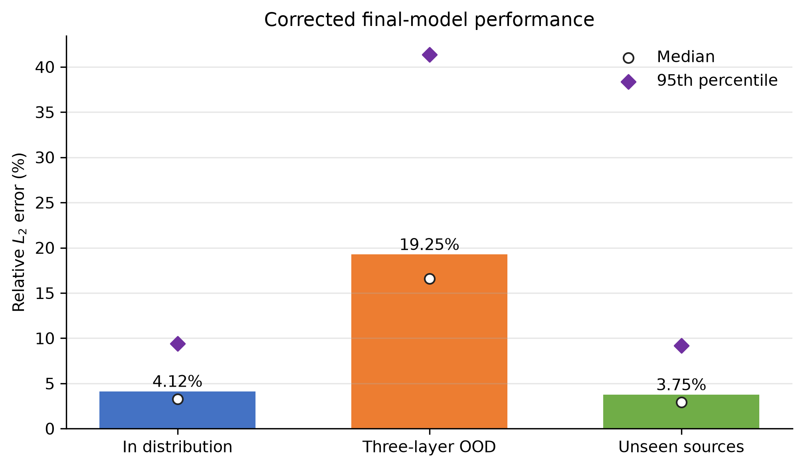

# NeutroNet: A DeepONet Study of Neutron Transport in Layered Media

NeutroNet is a DeepONet surrogate for the steady one-dimensional neutron transport equation in piecewise-constant layered media. It maps a spatial neutron source and material cross-section fields to scalar flux:

\[
[Q(x), \Sigma_t(x), \Sigma_s(x)] \longmapsto \phi(x)
\]

on a 100-cell, 10 cm slab. Reference solutions are generated with the included deterministic discrete-ordinates solver using an S32 angular quadrature, diamond-difference spatial discretization, source iteration, and vacuum boundaries. The benchmark uses bounded generated cross sections and is intended for research and reproducible operator-learning experiments.

Author: **H. Rainad Khan Rohan**



## Final model

The final checkpoint uses three independent branch encoders for the source, total cross section, and scattering cross section. Their features are fused and combined with a coordinate trunk by the DeepONet dot product.

| Property | Value |
|---|---:|
| Architecture | Separate-branch DeepONet |
| Grid | 100 cells over a 10 cm slab |
| Latent dimension | 64 |
| Trainable parameters | 137,985 |
| Training cases | 2,800 |
| Best validation epoch | 651 |
| Training loss | Mean squared relative L2 error |
| Optimizer | AdamW |
| Training seed | 20260920 |

### Verified performance

No single error measure is sufficient, so the retained evaluation reports dimensional, normalized, relative, and goodness-of-fit metrics together.

| Evaluation | MSE | RMSE | MAE | NRMSE | Mean relative L1 | Mean relative L2 | R2 |
|---|---:|---:|---:|---:|---:|---:|---:|
| Validation | 2.5797 | 1.6061 | 0.6040 | 7.75% | 3.62% | 4.09% | 0.9888 |
| In distribution | 5.2952 | 2.3011 | 0.5920 | 12.01% | 3.64% | 4.12% | 0.9725 |
| Three-layer material OOD | 13.2486 | 3.6399 | 1.9906 | 22.91% | 16.45% | 19.25% | 0.8818 |
| Six unseen source families | 1.3965 | 1.1817 | 0.4773 | 6.56% | 3.33% | 3.75% | 0.9914 |

MSE has squared-flux units; RMSE and MAE have flux units. NRMSE is normalized by target RMS. The JSON and CSV results additionally contain median and maximum absolute error, signed mean bias, interface MAE/RMSE, and relative-error percentiles. MAPE is intentionally omitted because near-zero boundary flux can make pointwise percentages unstable.

The main limitation is three-layer material generalization: training used one- and two-layer cases, and performance drops on the three-layer out-of-distribution evaluation. This is a synthetic research benchmark, not a validated reactor-analysis or safety tool.

## Repository layout

- `src/deeponet_1d/transport.py`: deterministic S_N reference solver.
- `src/deeponet_1d/sources.py`: seven corrected training source generators.
- `src/deeponet_1d/materials.py`: physically constrained layered materials.
- `src/deeponet_1d/dataset.py`: dataset construction with reference solves.
- `src/deeponet_1d/publication.py`: separate-branch architecture and reporting metrics.
- `data/final_model/`: all retained training and evaluation datasets.
- `results/final_model/model.pt`: best validation checkpoint.
- `results/final_model/metrics.json`: validation, ID, and three-layer results.
- `results/final_model/unseen_source_ood.json`: unseen-source results.
- `results/final_model/figures/`: publication figures in PNG and PDF.
- `MODEL_CARD.md` and `DATASET_CARD.md`: model, data, and limitation details.
- `CITATION.cff`: citation metadata.

## Reproduction

Python 3.11 was used. Create an environment and install the project with its dependencies:

```bash
python -m pip install -r requirements.txt
python -m pip install -e . --no-deps
python -m unittest discover -s tests -v
```

Regenerate the corrected datasets:

```bash
python scripts/generate_final_dataset.py \
  --output-dir data/final_model \
  --train-samples 2800 --validation-samples 350 \
  --test-samples 350 --ood-samples 350 \
  --directions 32 --base-seed 20260920 \
  --source-distribution mixed

python scripts/generate_unseen_source_ood.py \
  --output data/final_model/test_unseen_sources.npz \
  --samples-per-family 100 --directions 32 --seed 20260921
```

Train the retained model:

```bash
python scripts/train_final_model.py \
  --data-dir data/final_model \
  --output-dir results/final_model \
  --training-samples 2800 --loss relative_l2 \
  --epochs 1000 --batch-size 32 --latent-dim 64 \
  --learning-rate 0.0003 --weight-decay 0.000001 \
  --patience 120 --seed 20260920 --device cuda
```

Recompute the complete metric suite, evaluate unseen sources, and rebuild figures:

```bash
python scripts/recompute_saved_metrics.py \
  --run-dir results/final_model --data-dir data/final_model

python scripts/evaluate_checkpoint.py \
  --run-dir results/final_model \
  --dataset data/final_model/test_unseen_sources.npz \
  --output results/final_model/unseen_source_ood.json \
  --prediction-output results/final_model/unseen_source_ood_predictions.npz

python scripts/plot_final_model_results.py \
  --run-dir results/final_model --data-dir data/final_model

python scripts/plot_unseen_source_ood.py \
  --dataset data/final_model/test_unseen_sources.npz \
  --predictions results/final_model/unseen_source_ood_predictions.npz \
  --output-dir results/final_model/figures/unseen_source_ood
```

## Scope

This is a synthetic research benchmark, not a reactor-analysis or safety tool. The cross sections are sampled from bounded synthetic ranges, the experiment uses one generated data split and one final training seed, and the solver has not been cross-validated against an external transport code in this repository.
